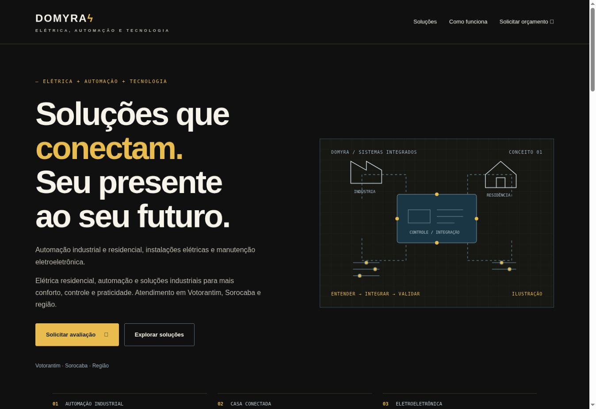

# Domyra

## Apresentação e objetivo
Apresentar serviços de elétrica e automação residencial e industrial.

## Participação real e inteligência artificial
Daniel de Omena Loubaque é responsável pelos objetivos, decisões de produto e acompanhamento do projeto. Desenvolvimento e documentação contam com IA; não se afirma autoria manual exclusiva nem experiência formal como desenvolvedor contratado.

## Tecnologias utilizadas
HTML, CSS e JavaScript em página estática. Tecnologias identificadas no projeto não equivalem a domínio avançado individual.

## Arquitetura
Página index.html estática, servida pelo GitHub Pages; robots.txt e sitemap.xml.

## Funcionalidades
Apresentação comercial, serviços, layout responsivo e canais de contato.

## Demonstração
https://danielloubaque.github.io/domyra-site/

## Capturas de tela
As capturas devem mostrar páginas públicas, sem sessões, tokens ou dados de terceiros. Consulte as imagens reais disponíveis no pacote do portfólio; nenhuma imagem sintética é apresentada como captura.

## Instalação
git clone https://github.com/Danielloubaque/domyra-site.git
cd domyra-site
python3 -m http.server 8000
Abrir http://localhost:8000.

## Testes e limites de validação
Sem suíte automatizada identificada. Verificação recomendada: navegação por teclado, links, contraste e telas de 360px e 1440px. Não declarar aprovação sem executar.

## Desafios técnicos
Manter uma presença comercial simples e acessível em diferentes telas.

## Soluções implementadas
Estrutura estática com conteúdo e estilos em index.html; descoberta por robots.txt e sitemap.xml.

## Próximas melhorias
Auditar acessibilidade, validar formulário e contatos; confirmar configuração do domínio comercial.

## Segurança
Este documento foi escrito para publicação, sem copiar histórico, credenciais ou dados comerciais privados. Os originais privados permanecem privados. Auditoria documental em 14/11/2026; não constitui garantia de ausência de vulnerabilidades.

## Contato
[Daniel no GitHub](https://github.com/Danielloubaque) · [LinkedIn](https://www.linkedin.com/in/daniel-loubaque-58443a240/) · [Vyntriva Tech](https://vyntriva-tech.bakedcharm.chatgpt.site)

## Captura real da página pública

